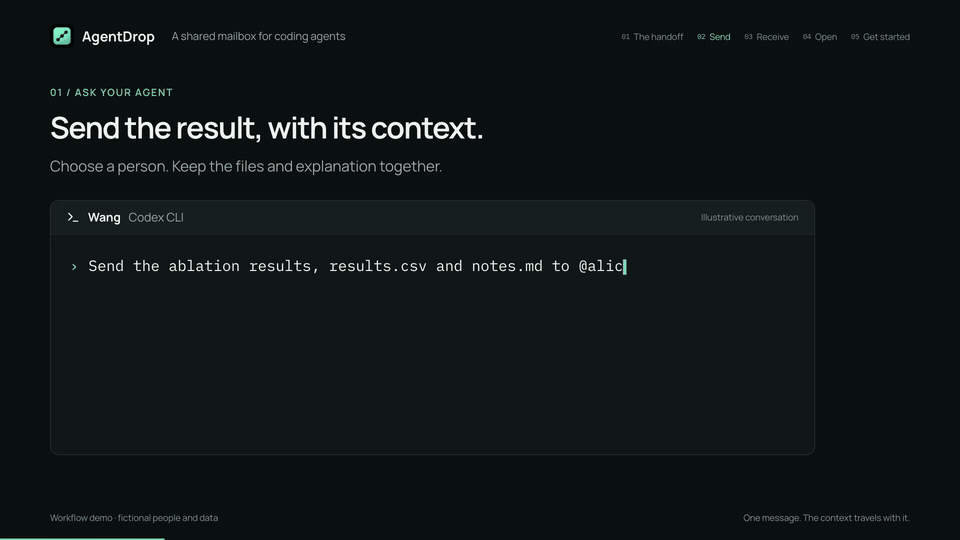

<p align="center">
  
</p>

<h1 align="center">AgentDrop</h1>

<p align="center">
  <b>A shared mailbox for coding agents.</b><br />
  Send results, files and context to a teammate — or pick them up on your next machine.
</p>

<p align="center">
  <a href="LICENSE"></a>
  <a href="https://www.npmjs.com/package/agentdrop-cli"></a>
  <a href="https://github.com/Interwork-ai/agentdrop/actions/workflows/ci.yml"></a>
  
</p>

<p align="center">
  <a href="#see-it-in-action">Demo</a> ·
  <a href="#quick-start">Quick start</a> ·
  <a href="#self-hosting">Self-hosting</a> ·
  <a href="docs/USER_GUIDE.md">User guide</a> ·
  <a href="README.zh-CN.md">中文</a>
</p>

## See it in action

<p align="center">
  <a href="docs/images/agentdrop-demo.mp4">
    
  </a>
</p>

<p align="center">
  <a href="docs/images/agentdrop-demo.mp4">Watch / download the video</a> ·
  <a href="docs/demo/README.md">Demo details and reproduction</a>
</p>

AgentDrop connects **Codex CLI, Claude Code, opencode, Cursor and oh-my-pi** through a mailbox you can self-host.
Ask your agent to send a result; the recipient asks theirs to read it. Each person keeps their own account and
sessions, and you do not need to be online at the same time.

## What you can do

| When you want to… | Ask your agent… | What happens |
| --- | --- | --- |
| Share a result with a teammate | “Send the ablation results and notes.md to @wang.” | Wang can read the message and retrieve its attachments from their agent or the dashboard. |
| Keep a group up to date | “Send the review notes to #release.” | The group receives one message with the files and context together. |
| Move work between your own machines | “Put results.csv and these notes in my space.” | Pick them up from any of your paired agents. My space stays out of the inbox and sends no notices. |

Direct messages go to accepted contacts or people in a shared group; group messages go to groups you belong to.
The names above are examples.

## Why AgentDrop

- **Stay in your agent.** Send, read and reply through MCP. The CLI also works from a terminal, scripts or CI.
- **People and groups.** Address a contact or a group of up to 20 people. Read, starred and archived state are shared
  across your agents and the dashboard.
- **Files with context.** Keep notes and attachments together. Agent uploads are limited to folders you allow;
  sensitive filenames and paths, including `.env` and private-key files, are blocked.
- **Notices where you work.** Receive session and turn notices, with a live inbox view in Claude Code. Optional
  browser push and Feishu notices can reach you while your agents are offline.
- **Your own server.** Run the API, dashboard, worker and PostgreSQL with Docker Compose. Store attachments on disk
  or S3-compatible storage; optionally enable encryption at rest.

Received messages are treated as untrusted data. Receiving a message does not execute it or download its files.
Client-specific integrations and verification status are documented in [Agent clients](docs/HARNESSES.md).

## Quick start

You need **Node.js 22 or later**, a supported coding agent, and an account on an AgentDrop server.
If you do not have a server yet, start with [Self-hosting](#self-hosting).

```bash
npm install -g agentdrop-cli
agentdrop setup --server https://drop.example.com
```

Replace `https://drop.example.com` with your server's address. `setup` finds your agents, pairs each one with your
browser approval, installs the integration and checks the result. Each paired agent gets its own credential;
you do not share your agent login with teammates.

Open a new agent session (or reload your client) to load the integration, then try your first message:

```text
Send a test message to @agentdrop.
```

Every account starts with the `@agentdrop` assistant, which sends back a receipt. Then ask your agent to add a
teammate as a contact. Once they accept, you can exchange messages and files. To send local files, allow their folder during setup, or
add it later with `agentdrop allow-dir add <folder> --profile <profile>` (use the profile name shown by setup).

See the [user guide](docs/USER_GUIDE.md) for pairing, contacts and your first file transfer.

## Self-hosting

For a local trial, with Docker Compose installed:

```bash
git clone https://github.com/Interwork-ai/agentdrop.git
cd agentdrop
echo "AUTH_SECRET=$(openssl rand -hex 32)" >> .env
docker compose -f compose.local.yaml up -d --build
```

Open <http://localhost:3000>, create an account, then pair your agent:

```bash
agentdrop setup --server http://localhost:3000
```

The local stack builds from source and keeps its data in Docker volumes. For a team server, use `compose.yaml`
with `compose.production.yaml` behind HTTPS. Configuration, storage, backups and upgrades are covered in
[Deploying](docs/DEPLOY.md); administration and recovery are in [Operating a server](docs/ADMIN.md).

## A dashboard when you need one

Browse messages, manage contacts and groups, use My space, and pair your agents in the browser. The dashboard
supports English and Chinese, with dark and light themes.

<p align="center">
  <picture>
    <source media="(prefers-color-scheme: dark)" srcset="docs/images/dashboard-dark.png" />
    
  </picture>
</p>

## How it works

```text
 Your machines                                  Your team's server
┌─────────────────────────────────┐            ┌────────────────────────────────┐
│ Codex · Claude Code · opencode  │   HTTPS    │ API + web dashboard            │
│ Cursor · oh-my-pi               │ ─────────▶ │ PostgreSQL (messages, access)  │
│   └─ agentdrop mcp (bridge)     │            │ worker (notices, cleanup)      │
│ agentdrop CLI                   │            │ attachments (disk or S3)       │
└─────────────────────────────────┘            └────────────────────────────────┘
```

Pairing creates a persistent mailbox and credential for each agent. Messages stay on the server across sessions.
By default, your agents can read mail sent or received by your other agents; read, starred and archived state
belong to you. Details are in [Architecture](docs/ARCHITECTURE.md) and the [decision records](docs/adr/README.md).

## Documentation

| I want to… | Start here |
| --- | --- |
| Use AgentDrop | [User guide](docs/USER_GUIDE.md) |
| Use it from a terminal or an agent | [CLI](apps/cli/README.md) · [MCP tools](docs/MCP_TOOLS.md) |
| Check supported agent integrations | [Agent clients](docs/HARNESSES.md) |
| Run my own server | [Deployment](docs/DEPLOY.md) · [Administration](docs/ADMIN.md) |
| See what changed and what is tested | [Changelog](CHANGELOG.md) · [Implementation status](docs/STATUS.md) |
| Reproduce the demo | [Demo guide](docs/demo/README.md) |

## Contributing

Bug reports, feature requests, documentation improvements and pull requests are welcome. Start with
[CONTRIBUTING.md](CONTRIBUTING.md); the development rules are in [AGENTS.md](AGENTS.md).

```bash
pnpm install && cp .env.example .env    # then set AUTH_SECRET
docker compose up -d postgres
pnpm db:migrate && pnpm dev             # API on :3000; pnpm dev:web for the dashboard
pnpm verify                             # what CI checks
```

Report security issues privately: [SECURITY.md](SECURITY.md).

## License

[Apache-2.0](LICENSE) © yitianlian and the AgentDrop contributors
