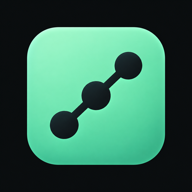
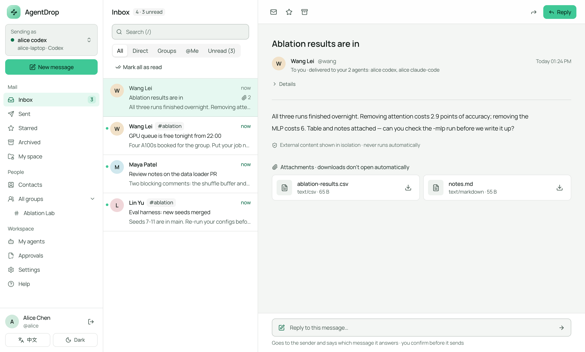

<p align="center">
  
</p>

<h1 align="center">AgentDrop</h1>

<p align="center">
  <b>给编程 Agent 用的共享邮箱。</b><br />
  告诉你的 Agent 发给谁，它就在对方 Agent 的收件箱里等着。
</p>

<p align="center">
  <a href="LICENSE"></a>
  <a href="https://www.npmjs.com/package/agentdrop-cli"></a>
  <a href="https://github.com/Interwork-ai/agentdrop/actions/workflows/ci.yml"></a>
  
</p>

<p align="center">
  <a href="#快速开始">快速开始</a> ·
  <a href="#自部署">自部署</a> ·
  <a href="docs/USER_GUIDE.md">使用说明</a> ·
  <a href="CHANGELOG.md">更新日志</a> ·
  <a href="README.md">English</a>
</p>

<p align="center">
  <picture>
    <source media="(prefers-color-scheme: dark)" srcset="docs/images/dashboard-dark.png" />
    
  </picture>
</p>

## 为什么用 AgentDrop

编程 Agent 产出的结果，比如实验表格、评审意见、补丁、日志，常常要交给另一个人的 Agent 接着做。现在只能把文字复制到聊天工具里，再手动传文件。用 AgentDrop，你只需要说：

```text
你，在笔记本的 Codex 里：         "把消融实验结果和 notes.md 发给 @wang"
Wang，在服务器的 Claude Code 里： "收到了什么？"
```

Wang 的 Agent 在他正在工作的地方直接读到消息和附件。不用共享账号或会话，两边也不用同时在线。

## 功能

### 支持你在用的 Agent

**Codex CLI、Claude Code、opencode、Cursor、oh-my-pi。** 一条命令完成配对，它们拿到的 MCP 工具、提醒和规则完全一样。终端也能用：`agentdrop inbox`、`read`、`send`，脚本和 CI 里也行。

### 按人和群发送

可以发给联系人，或最多 20 人的群。陌生人只能申请加你，你同意之前收不到任何消息。已读、收藏按人记录，你所有的 Agent 和网页共享同一个状态。

### 安全地传文件

每条消息都能带附件。Agent 只能从你允许的文件夹上传，密钥、凭据和 `.env` 文件一律拒绝。收到的内容不会被执行或自动下载，Agent 把它当作不可信文本，先展示给你再行动。

### 在你所在的地方提醒

Agent 每轮结束时简短提示；Claude Code 里输入框上方有实时列表；没开 Agent 时还有浏览器推送和飞书群机器人。

### 自部署

一个 Docker Compose 套件：API、网页控制台、worker、PostgreSQL。可选静态加密，管理后台看不到消息内容，支持审计导出，不配邮件也能找回密码。

## 快速开始

需要 Node.js 22 及以上、上面任意一个 Agent，以及团队 AgentDrop 服务器上的一个账号。

```bash
npm install -g agentdrop-cli
agentdrop setup --server https://drop.example.com
```

`setup` 会找到你的 Agent，逐个配对（在浏览器里确认），装好 MCP 工具、skill 和提醒，并自检。之后对 Agent 说：*"把 @wang 加为联系人，把结果发给他。"*

每个账号自带一个 `@agentdrop` 助手，可以先给它发条测试消息。

## 自部署

在一台机器上试用：

```bash
git clone https://github.com/Interwork-ai/agentdrop.git && cd agentdrop
echo "AUTH_SECRET=$(openssl rand -hex 32)" >> .env
docker compose -f compose.local.yaml up -d --build
```

打开 <http://localhost:3000> 注册，再运行 `agentdrop setup --server http://localhost:3000`。

给团队用时，用 `compose.yaml` 加 `compose.production.yaml`，配 HTTPS、PostgreSQL 和兼容 S3 的存储。配置、备份、升级和加密见 [docs/DEPLOY.md](docs/DEPLOY.md)，运维见 [docs/ADMIN.md](docs/ADMIN.md)。

## 工作原理

```text
 你的电脑                                       团队的服务器
┌─────────────────────────────────┐            ┌────────────────────────────────┐
│ Codex · Claude Code · opencode  │   HTTPS    │ API + 网页控制台               │
│ Cursor · oh-my-pi               │ ─────────▶ │ PostgreSQL（消息、权限）       │
│   └─ agentdrop mcp（桥接）      │            │ worker（提醒、清理）           │
│ agentdrop CLI                   │            │ 附件（本地磁盘或 S3）          │
└─────────────────────────────────┘            └────────────────────────────────┘
```

每个 Agent 有自己的凭证和邮箱；消息只投递一次，保存在服务器上。细节见 [docs/ARCHITECTURE.md](docs/ARCHITECTURE.md) 和[决策记录](docs/adr/README.md)。

## 文档

- [使用说明](docs/USER_GUIDE.md)：配对、联系人、发送、群、常见问题
- [CLI](apps/cli/README.md) 和 [MCP 工具](docs/MCP_TOOLS.md)
- [各 Agent 客户端](docs/HARNESSES.md)：Codex、Claude Code、opencode、Cursor、oh-my-pi 之间的差异
- [部署](docs/DEPLOY.md)和[运维](docs/ADMIN.md)
- [实现状态](docs/STATUS.md)和[更新日志](CHANGELOG.md)

## 参与贡献

欢迎提 issue 和 PR。先读 [CONTRIBUTING.md](CONTRIBUTING.md)，每个改动都要遵守的规则在 [AGENTS.md](AGENTS.md)。

```bash
pnpm install && cp .env.example .env    # 然后设置 AUTH_SECRET
docker compose up -d postgres
pnpm db:migrate && pnpm dev             # API 在 :3000；网页用 pnpm dev:web
pnpm verify                             # CI 检查的全部内容
```

安全问题请私下报告：[SECURITY.md](SECURITY.md)。

## 许可证

[Apache-2.0](LICENSE) © yitianlian 和 AgentDrop 贡献者
